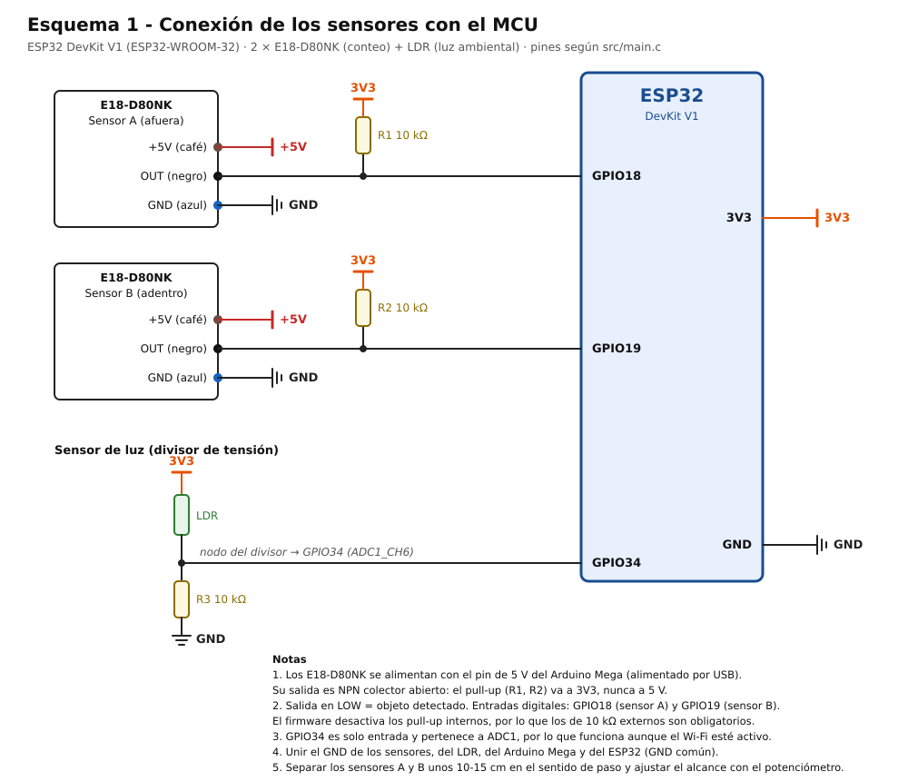
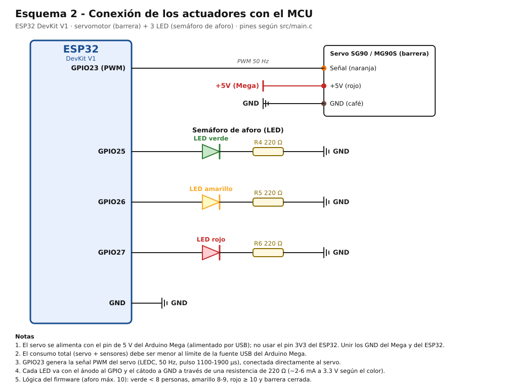

# Capa de Percepción IoT: aforo inteligente

Nodo de borde basado en ESP32 para contar entradas y salidas de personas en un espacio cerrado, medir la luz ambiental y accionar un semáforo LED y una barrera con servomotor. Corresponde al **Entregable No. 1 (capa de percepción)** del curso Internet de las Cosas, Universidad de Antioquia, 2026-2, y hace parte del proyecto *Sistema IoT de Aforo Inteligente para Espacios Cerrados*.

Firmware en C con **PlatformIO + ESP-IDF + FreeRTOS**.

## Integrantes

- Juan Sebastián Galeano Aristizábal: Juans.galeano@udea.edu.co
- Carlos Santiago Estacio Malte: santiago.estacio@udea.edu.co
- Tomás Cadavid Martínez: tomas.cadavid@udea.edu.co

## Qué hace

- Detecta el sentido de paso con dos sensores infrarrojos E18-D80NK (A → B es entrada y B → A es salida), con *debounce* y descarte de secuencias incompletas.
- Mide la luz con una fotorresistencia (LDR) y aplica una media móvil de 10 muestras.
- Señaliza la ocupación con tres LED: verde (menos de 8 personas), amarillo (8 o 9) y rojo (10 o más, con el aforo máximo en 10).
- Cierra la barrera (servo SG90) al llegar al aforo máximo y la abre temporalmente cuando detecta un intento de salida.
- Emite por el puerto serial un mensaje JSON cada segundo, listo para la futura publicación por MQTT.

La conectividad Wi-Fi/MQTT, el servidor y el tablero corresponden a las siguientes entregas.

## Hardware

| Componente | Cantidad | Función |
|---|---|---|
| ESP32 DevKit V1 (30 pines), módulo ESP-32S | 1 | Microcontrolador |
| Sensor infrarrojo E18-D80NK | 2 | Conteo y sentido de paso |
| Fotorresistencia (LDR) | 1 | Luz ambiental |
| LED verde, amarillo y rojo | 3 | Semáforo de aforo |
| Servomotor SG90 | 1 | Barrera |
| Resistencias 10 kΩ | 3 | *Pull-up* de los dos IR y divisor de la LDR |
| Resistencias 220 Ω | 3 | Limitación de corriente de los LED |
| Arduino Mega 2560 (por USB) | 1 | Fuente de 5 V del montaje |

## Asignación de pines

| GPIO | Dirección | Símbolo en el código | Función |
|---|---|---|---|
| 18 | Entrada | `SENSOR_A` | IR exterior |
| 19 | Entrada | `SENSOR_B` | IR interior |
| 25 | Salida | `LED_VERDE` | Aforo disponible |
| 26 | Salida | `LED_AMARILLO` | Casi lleno |
| 27 | Salida | `LED_ROJO` | Aforo completo |
| 23 | PWM (LEDC) | `SERVO_GPIO` | Señal del servo, 50 Hz |
| 34 | ADC1 canal 6 | `CANAL_LDR` | Divisor de la LDR |

## Conexiones

- **E18-D80NK:** cable café a 5 V, azul a GND y negro (salida) al GPIO. La salida es NPN de colector abierto, así que cada canal lleva una resistencia *pull-up* de 10 kΩ a **3.3 V** (nunca a 5 V). El firmware desactiva los *pull-up* internos, por lo que las externas son obligatorias.
- **LDR:** 3.3 V, LDR, nodo conectado a GPIO34, resistencia de 10 kΩ a GND.
- **LED:** ánodo al GPIO; cátodo a GND a través de una resistencia de 220 Ω.
- **Servo SG90:** señal a GPIO23, 5 V y GND. Se alimenta desde el pin de 5 V de un Arduino Mega 2560 conectado por USB, con GND común con el ESP32.
- **GND común** entre sensores, LDR, servo, Arduino Mega y ESP32.

Nunca se debe conectar 5 V a un pin GPIO del ESP32.

## Esquemas de conexión

## Arquitectura del firmware

Cinco tareas FreeRTOS, dos colas de un elemento (con sobrescritura) y un mutex.

| Tarea | Prioridad | Pila | Responsabilidad |
|---|---|---|---|
| `tarea_aforo` | 5 | 4096 | Lee los IR, filtra y confirma el sentido de paso (máquina de estados) |
| `tarea_semaforo` | 4 | 3072 | Recibe la ocupación por cola y conmuta los LED |
| `tarea_servo` | 4 | 3072 | Recibe abrir/cerrar por cola y genera el PWM |
| `tarea_ldr` | 3 | 3072 | Lee el ADC y calcula la media móvil |
| `tarea_json` | 2 | 4096 | Copia los datos bajo mutex y emite el JSON cada 1 s |

Parámetros principales (constantes `#define` en `src/main.c`): aforo máximo 10, umbral amarillo 8, lectura de IR cada 10 ms, *debounce* de 40 ms, timeout de secuencia de 2500 ms, rearme de 300 ms, LDR cada 100 ms con 10 muestras, JSON cada 1000 ms y servo a 50 Hz con 14 bits (pulso de 1100 µs cerrado y 1900 µs abierto).

La LDR usa un canal de ADC1 porque ADC2 no se puede usar con el Wi-Fi activo, que se necesitará en la siguiente entrega.

## Compilar y ejecutar

Requisitos: Visual Studio Code con la extensión PlatformIO IDE y una placa ESP32 conectada con un cable USB **de datos**.

~~~bash
pio run                 # compilar
pio run -t upload       # grabar en la placa
pio device monitor      # monitor serial a 115200 baudios
~~~

Configuración (`platformio.ini`): plataforma `espressif32`, placa `esp32dev`, framework `espidf`.

## Salida esperada

~~~text
Sensor A: LIBRE
Sensor B: DETECTADO
Secuencia A -> B detectada
LDR -> Lectura: 353 | Media movil: 353
Sensor B: LIBRE

ENTRADA CONFIRMADA
OCUPACION ACTUAL: 8
AFORO MAXIMO: 10
ESTADO: CASI LLENO
SEMAFORO: AMARILLO - CASI LLENO
~~~

Mensaje JSON periódico (valores ilustrativos):

~~~json
{"dispositivo":"esp32_aforo_01","tiempo_ms":655080,"ocupacion":8,"aforo_maximo":10,"sensor_a":false,"sensor_b":false,"ldr_raw":353,"ldr_filtrado":353,"ldr_valida":true,"semaforo":"amarillo","barrera":"abierta"}
~~~

`tiempo_ms` es el tiempo desde el arranque. El campo `barrera` indica la posición ordenada al servo, no una medición mecánica.

## Estructura del repositorio

~~~text
.
├── platformio.ini
├── CMakeLists.txt
├── .gitignore
├── .vscode/
│   └── extensions.json
├── docs/
│   ├── esquema_sensores.svg
│   └── esquema_actuadores.svg
└── src/
    ├── CMakeLists.txt
    └── main.c
~~~

## Pruebas realizadas

Pruebas manuales con el prototipo armado: incremento y decremento del contador con las secuencias A → B y B → A, descarte de pulsos incompletos o simultáneos, variación continua de la LDR con luz y sombra, cambio del semáforo según el umbral, apertura y cierre del servo, apertura temporal ante una salida con aforo completo y emisión periódica del JSON.

## Limitaciones

- No distingue dos personas pasando juntas ni cruces simultáneos en sentidos opuestos.
- Los sensores reflectivos pueden perder alcance con superficies muy oscuras y requieren ajustar el potenciómetro en cada instalación.
- La lectura de la LDR es relativa y no está calibrada en lux.
- El contador está en RAM y se reinicia si el ESP32 se reinicia.
- La alimentación de 5 V depende del puerto USB del Arduino Mega; en una instalación real convendría una fuente dedicada.
- Es un prototipo didáctico, no un mecanismo certificado de control de acceso o evacuación.

## Siguientes pasos

Conexión Wi-Fi y publicación del JSON por MQTT sobre TLS hacia un broker Mosquitto, almacenamiento en una base de series de tiempo y tablero de visualización.

## Uso de IA

El uso de herramientas de IA en este entregable se declara en la sección de transparencia del informe.
